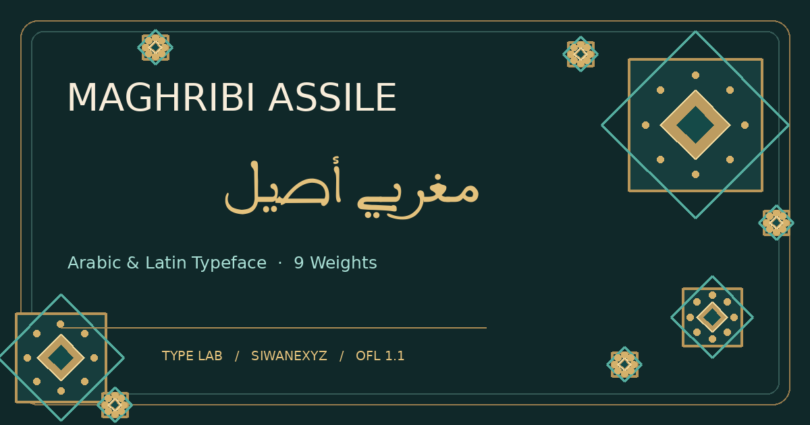

# Maghribi Assile

**[Live Type Lab](https://elhizazi1.github.io/Font-Maghribi-Assile/)** · [GitHub repository](https://github.com/elhizazi1/Font-Maghribi-Assile)

**Version 3.0.0 · Experimental · SIL Open Font License 1.1**

An Arabic and Latin font family with nine static weights, maintained by **Jamal El Hizazi** (foundry **SiwaneXYZ**, project **RawanIDE**).

## Interactive preview

Open [index.html](index.html) to preview and compare all nine weights, enter custom text, and download individual fonts. The page works offline with the included `fonts/` folder. If local file restrictions prevent font loading, serve the directory using `python -m http.server 8000`.

## Styles

| Style | Weight |
| --- | ---: |
| Thin | 100 |
| ExtraLight | 200 |
| Light | 300 |
| Regular | 400 |
| Medium | 500 |
| SemiBold | 600 |
| Bold | 700 |
| ExtraBold | 800 |
| Black | 900 |

TTF files: [`fonts/ttf/`](fonts/ttf/). Webfonts: [`fonts/woff2/`](fonts/woff2/). CSS: [`css/maghribi-assile.css`](css/maghribi-assile.css).

## Quality status

All nine weights pass structural checks using `fontTools` and include 414 glyphs, GSUB and GPOS. **Eight non-Regular weights are algorithmically derived and remain experimental.** Structural checks do not establish professional optical quality, comprehensive Arabic shaping correctness, or acceptance by Google Fonts. Independent visual review and additional shaping tests are recommended before production deployment.

Run `python -m pip install -r requirements.txt` and `python scripts/verify.py` to validate the files. GitHub Actions runs this check automatically.

## Source and contributions

The `sources/` folder contains a current TTX representation of the Regular font. Contributions are welcome via GitHub issues and pull requests. See [CONTRIBUTING.md](CONTRIBUTING.md).

## License

SIL Open Font License 1.1. See [OFL.txt](OFL.txt). Copyright © 2026 Jamal El Hizazi (SiwaneXYZ).

## Website & social sharing

The repository root is ready for **GitHub Pages** (Settings → Pages → Deploy from a branch → `main` / `(root)`).
The site includes an original favicon, Apple touch icon, 1200 × 630 Open Graph image, Twitter summary card metadata, canonical URL, sitemap, robots.txt, and web app manifest.

For the GitHub **repository social preview** (different from the website's Open Graph image), upload `assets/og-image.png` in **Settings → General → Social preview**.

Suggested GitHub description: `Open-source Moroccan Arabic & Latin font family — 9 experimental weights, live type lab, TTF/WOFF2, SIL OFL 1.1.`
Suggested topics: `arabic-font`, `moroccan`, `typography`, `font-family`, `open-source-font`, `zellige`, `latin-font`, `woff2`, `ttf`.
